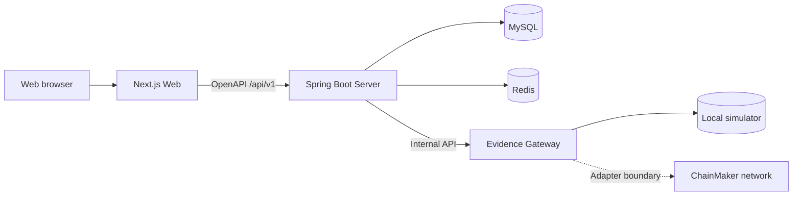

# EduChain

面向教育知识共享、智能检索与可信存证的一体化开源系统。

> An open-source platform for educational knowledge sharing, intelligent discovery, and verifiable evidence.

EduChain 将内容创作、公开阅读、分类检索、社区互动和原创存证组织在同一套产品体验中。项目采用 Web、Java Server、Evidence Gateway 三应用架构，既支持零后端依赖的 Mock 演示，也支持 MySQL、Redis 与本地存证模拟器组成的完整联调环境。

## 核心能力

- **知识创作与发布**：资源草稿、附件上传、版本管理、发布、下架与恢复。
- **发现与检索**：关键词、分类、标签、排序、推荐反馈、搜索历史与热门词。
- **学习社区**：公开资源、点赞、收藏夹、评论、关注、通知、活动与成就。
- **可信存证**：确定性摘要、Merkle Root、可靠任务、核验页面和 PDF 证书。
- **链上信息**：统一查看交易、区块、网络、证明状态与资源关联。
- **治理后台**：用户、内容、举报、分类、存证、审计、告警、设置和维护任务。
- **平台基础**：中英文、主题切换、统一错误模型、权限、安全响应头和可观测性。

## 系统架构



- Web 通过同一个数据访问层连接 Mock 或真实 API，业务组件不感知底层模式。
- Java Server 使用模块化 MVC 单体，Controller、Service、Repository、Entity 与 DTO 职责分离。
- Evidence Gateway 隔离链实现细节，业务服务不直接依赖区块链 SDK。
- OpenAPI 是 Web、Mock 和 Java 之间的公共契约来源。

更完整的上下文、容器边界和数据流见 [架构文档](docs/02-architecture/00-system-architecture.md)。

## 技术栈

| 范围             | 主要技术                                                       |
| ---------------- | -------------------------------------------------------------- |
| Web              | Next.js、React、TypeScript、Tailwind CSS、TanStack Query       |
| 国际化与内容     | Intlayer                                                       |
| Mock             | Mock Service Worker                                            |
| Java Server      | Java 21、Spring Boot、Spring MVC、Spring Security、JPA、Flyway |
| Evidence Gateway | Python 3.12、FastAPI、Pydantic                                 |
| 数据             | MySQL、Redis、SQLite 模拟器                                    |
| 契约与交付       | OpenAPI 3.1、Docker Compose、GitHub Actions                    |

依赖版本由各应用清单和锁文件固定，不以 README 中的文字替代实际构建配置。

## 仓库结构

```text
.
├── apps/
│   ├── web/                # Next.js 前端、Intlayer 与 Mock
│   ├── server/             # 模块化 Spring MVC 服务
│   └── evidence-gateway/   # 模拟器与长安链适配边界
├── packages/
│   ├── api-contract/       # OpenAPI 与生成的 TypeScript 类型
│   └── design-tokens/      # 跨页面设计令牌
├── docs/                   # 产品、架构、数据、运维与 ADR
├── scripts/                # 自动结构门禁
├── .github/                # CI 与社区协作模板
└── compose.yaml            # 完整本地运行环境
```

## 快速开始

### 完整本地环境

前置条件：Docker 与 Docker Compose。

```bash
docker compose up --build
```

服务启动后：

- Web：<http://127.0.0.1:3000/zh-CN>
- Java 健康检查：<http://127.0.0.1:8080/api/v1/health>
- Evidence Gateway 健康检查：<http://127.0.0.1:8081/health>

本地管理员账号只用于本机联调：

```text
账号：demo@educhain.local
密码：Trustworthy!Demo
```

停止服务但保留本地数据卷：

```bash
docker compose down
```

不要在公开或生产环境继续使用 Compose 中的演示凭据与本地密钥。

### 仅运行 Mock Web

前置条件：Node.js 24 与 pnpm 10。

```bash
corepack enable
pnpm install --frozen-lockfile
cp apps/web/.env.example apps/web/.env.local
pnpm dev:web
```

Mock 模式会在浏览器内启动与 OpenAPI 形状一致的模拟接口，不需要 Java、Python、MySQL 或 Redis。登录页提供本地管理员快捷入口。

### GitHub Pages Mock 演示

仓库提供独立的静态导出模式，目标地址为 <https://jemzhao.github.io/EduChain/>。该演示使用浏览器内 Mock Service Worker，不连接 Java Server、Evidence Gateway 或生产数据；登录状态、草稿和互动数据只保存在当前浏览器中。

本地生成与 GitHub Pages 一致的静态产物：

```bash
pnpm build:web:pages
```

产物位于 `apps/web/out`。合并到 `main` 后，[Pages 工作流](.github/workflows/pages.yml) 会构建并发布该目录；首次启用时需在仓库 Settings → Pages 中将 Source 设为 GitHub Actions。

## Mock 与 Remote 模式

| 模式     | 用途                         | 数据来源                     | 允许环境       |
| -------- | ---------------------------- | ---------------------------- | -------------- |
| `mock`   | 前端开发、静态演示、视觉评审 | 浏览器内 Mock Service Worker | 本地或静态导出 |
| `remote` | 联调、验收、服务端部署       | Java Server 与数据库         | 非本地可用     |

配置示例位于 [apps/web/.env.example](apps/web/.env.example)。除显式静态导出外，非本地环境启用 Mock 会被运行时保护直接拒绝。

## 质量检查

Web、契约与结构：

```bash
pnpm install --frozen-lockfile
pnpm format:check
pnpm structure:check
pnpm contract:validate
pnpm contract:generate
pnpm --filter @educhain/web typecheck
pnpm --filter @educhain/web lint
pnpm --filter @educhain/web build
```

Java Server：

```bash
cd apps/server
./mvnw --batch-mode verify
```

Evidence Gateway：

```bash
cd apps/evidence-gateway
python -m pip install -e '.[dev]'
ruff check src tests
ruff format --check src tests
mypy src
pytest
```

[GitHub Actions CI](.github/workflows/ci.yml) 会分别执行 Web 与契约、Java Server、Evidence Gateway 三组检查。结构门禁还会阻止巨型职责文件、错误依赖方向、重复契约产物和开源治理文件缺失。

## 文档

从 [docs/README.md](docs/README.md) 开始阅读完整文档：

- [产品需求](docs/01-product/00-product-requirements.md)
- [系统架构](docs/02-architecture/00-system-architecture.md)
- [前端蓝图](docs/03-frontend/00-frontend-blueprint.md)
- [Java 模块化 MVC](docs/04-backend/00-modular-mvc-blueprint.md)
- [存证架构](docs/05-evidence/00-blockchain-evidence.md)
- [运行手册](docs/08-operations/02-runtime-runbook.md)
- [质量门禁](docs/08-operations/01-quality-gates.md)
- [实现核验记录](docs/09-delivery/04-implementation-verification.md)
- [架构决策与文档索引](docs/README.md)

## 存证边界

仓库内置的本地模拟器用于验证摘要、任务状态、核验与证书闭环，不代表真实区块链确认。连接真实长安链需要部署方提供网络、合约、组织证书、最小权限密钥和适配配置，并按部署环境单独验收。

## 参与贡献

提交改动前请阅读 [CONTRIBUTING.md](CONTRIBUTING.md) 和 [CODE_OF_CONDUCT.md](CODE_OF_CONDUCT.md)。普通问题使用 Issue 模板；未公开安全问题必须按照 [SECURITY.md](SECURITY.md) 私密报告。

版本级变化记录在 [CHANGELOG.md](CHANGELOG.md)，使用帮助见 [SUPPORT.md](SUPPORT.md)。

## 许可证

本项目采用 [Apache License 2.0](LICENSE)。除许可证明确授予的权利外，项目名称与标识不自动授予商标使用权。
