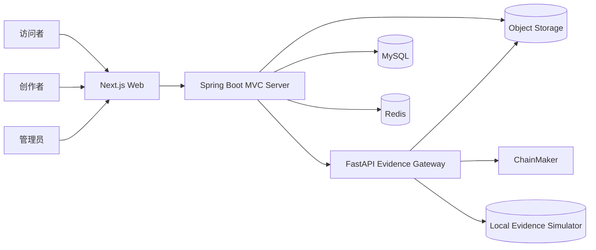

# 系统总体架构

- 状态：Accepted

## 1. 架构风格

EduChain 采用三个可独立运行的应用与若干基础设施组件：

1. Next.js Web：呈现公开站点、用户工作区和管理后台。
2. Spring Boot Server：模块化 MVC 单体，承载核心业务事实和权限。
3. FastAPI Evidence Gateway：封装证明计算、长安链接入、本地模拟和证书生成。

该结构在毕业设计规模下保持边界清晰，同时避免微服务带来的分布式事务、服务发现和多套运维负担。

## 2. 系统上下文

## 3. 责任边界

### 3.1 Web

- 路由、渲染、交互、表单和可访问性。
- 会话展示与请求协调，不自行决定最终权限。
- Intlayer 内容字典、区域格式和 SEO 元数据。
- 基于同一接口契约切换 Mock 与真实后端。
- 不保存业务事实，不直接连接数据库或长安链。

### 3.2 Server

- 用户、资源、版本、互动、关系、通知、搜索、治理和任务状态。
- 身份认证、对象级授权、审计与幂等。
- 数据事务、缓存一致性和异步任务协调。
- 调用存证网关并把外部结果映射为稳定业务状态。
- 不包含长安链 SDK，不生成依赖具体节点格式的证书。

### 3.3 Evidence Gateway

- 内容规范化、SHA-256、Merkle Tree 和证明载荷构造。
- 真实长安链适配器、本地模拟适配器和明确的运行模式。
- 提交、查询、确认、核验和证书生成。
- 保护节点证书、私钥和 SDK 配置。
- 不决定用户能否发布资源，不管理点赞、评论或用户资料。

## 4. 核心数据流

### 4.1 读取资源

Web 请求 Server → Server 完成可见性判断 → 读取 MySQL → 使用 Redis 缓存加速允许缓存的数据 → 返回稳定 DTO → Web 服务端渲染主要内容。

### 4.2 发布资源

Web 提交发布命令 → Server 校验用户、草稿和附件 → 在单个业务事务内创建公开版本与任务记录 → 返回已发布且证明处理中的状态 → 后台工作器处理索引和证明任务。

### 4.3 完成证明

Server 工作器以幂等键调用 Gateway → Gateway 选择适配器并提交 → 返回受理结果 → Server 轮询或接收内部回调 → 保存已确认事实 → 触发证书和通知。

## 5. 同步与异步边界

同步完成：

- 身份校验、资源字段校验、草稿保存、发布事务、互动写入、权限判断。
- 搜索请求和公开核验查询。

异步完成：

- 全文索引更新。
- 长安链提交和确认。
- 证书生成。
- 通知扇出。
- 统计聚合与临时文件清理。

用户界面必须显示异步状态，不能用长时间阻塞请求伪装同步完成。

## 6. 依赖规则

- Web 只依赖公开 API 契约，不依赖 Server 内部模型。
- Server 业务模块不能依赖 Gateway 的 SDK 类型。
- Gateway 的真实链适配器和模拟适配器实现同一内部端口。
- MySQL 是业务事实来源；Redis 丢失后系统可以恢复核心功能。
- 搜索索引属于可重建派生数据，不反向覆盖业务事实。
- 文件对象通过稳定对象标识引用，数据库不保存机器本地绝对路径。

## 7. 部署单元

- `web`：无状态，可水平扩展。
- `server`：无状态 API 与受控后台工作器，可从同一制品以不同角色启动。
- `evidence-gateway`：限制网络和密钥访问，独立扩展。
- `mysql`：持久化主数据。
- `redis`：缓存、限流、锁和短期任务辅助。
- `object-storage`：资源文件、头像和证书。
- `chainmaker`：真实环境独立部署，本地开发可使用模拟器。
