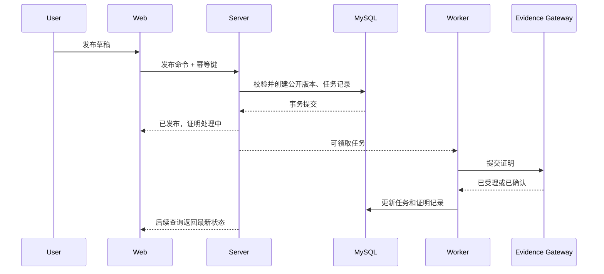

# 运行流程与集成约定

- 状态：Accepted

## 1. 请求标识

- Web 为每次用户动作生成或传递 `requestId`。
- Server 接受合法标识，否则生成新标识。
- Server 调用 Gateway 时传递 `requestId`、`traceparent` 和稳定幂等键。
- 日志、错误响应和审计记录使用可公开的关联标识，不暴露内部堆栈。

## 2. 资源发布时序

### 2.1 事务边界

发布事务只覆盖 Server 自己的 MySQL 写入。不得在数据库事务内等待长安链、对象存储的大文件传输或证书生成。

### 2.2 任务领取

- 使用数据库任务表作为可靠事实。
- 工作器通过行锁或等价机制领取任务。
- 任务包含尝试次数、下次执行时间、租约时间和最后错误分类。
- 超出租约的处理中任务可被安全重新领取。

## 3. 证明提交语义

- 幂等键由资源标识、版本标识、摘要算法版本和证明后端组成。
- Gateway 对同一幂等键返回同一受理结果或最终结果。
- 网络超时属于结果未知，不直接判定失败；先查询再决定是否重试。
- 业务状态与外部状态通过明确映射表转换，未知外部值进入人工关注状态。

## 4. 文件上传流程

1. Web 向 Server 请求上传会话。
2. Server 校验用户、用途、大小、数量和允许类型。
3. Web 上传到受控入口或短时签名地址。
4. Server 接收完成通知并校验对象元数据。
5. 后台任务执行文件签名检查、安全扫描和摘要计算。
6. 只有状态为可用的对象才能绑定到发布版本。

文件状态：`CREATED`、`UPLOADING`、`SCANNING`、`AVAILABLE`、`REJECTED`、`EXPIRED`。

## 5. 索引更新

- 资源发布、更新公开版本、下架和恢复会生成索引任务。
- 索引记录包含业务版本号，旧任务不得覆盖新状态。
- 检索索引丢失时可以从 MySQL 重建。
- 列表与详情的最终可见性仍由 Server 检查，不能只信任索引结果。

## 6. 缓存策略

- 只缓存读取密集且可明确失效的数据。
- 缓存键包含命名空间、对象标识、版本和必要的语言维度。
- 更新业务事实后执行删除缓存，不做复杂的缓存内原地修改。
- 缓存故障时降级到数据库，并通过限流保护数据库。
- 身份权限的关键判定不依赖长时间缓存。

## 7. 通知流程

- 业务事务内写入通知意图或可靠任务，不直接依赖实时发送成功。
- 相同业务事件生成稳定去重键。
- 用户偏好在发送前检查。
- 站内通知记录与外部邮件发送状态分离。

## 8. 超时与重试

| 调用                    | 超时原则   | 重试原则                       |
| ----------------------- | ---------- | ------------------------------ |
| Web → Server 读取       | 短超时     | 用户触发或有限自动重试         |
| Web → Server 写入       | 明确超时   | 只有具备幂等键时自动重试       |
| Server → Gateway 提交   | 中等超时   | 结果未知先查询                 |
| Gateway → ChainMaker    | SDK 级超时 | 按错误分类指数退避             |
| Server → Object Storage | 分操作设置 | 读取可重试，写入依赖对象幂等性 |

任何无限重试都被禁止。达到上限后进入可观察、可人工处理的终止状态。
