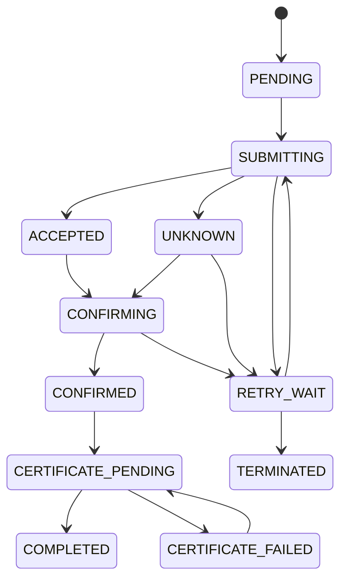

# 区块链存证模型

- 状态：Accepted

## 1. 目标与边界

系统证明“某个资源版本的确定性摘要在某个时间由指定证明后端确认，并与声明的作者和资源标识关联”。系统不把完整资源正文上传到链上，也不自动给出法律所有权结论。

## 2. 证明对象

一个证明对象绑定：

- 资源稳定标识。
- 已发布版本标识。
- 作者稳定标识的不可逆表示。
- 内容规范版本。
- 主摘要算法和摘要值。
- 附件摘要集合或 Merkle Root。
- 证明载荷版本。
- 提交与确认时间。
- 证明后端和网络标识。
- 交易标识、区块高度和区块哈希等可用信息。

## 3. 链上与链下数据

链上保存最小证明数据：资源与版本的稳定引用、摘要、作者证明标识、载荷版本和必要时间信息。

链下保存：标题、摘要、正文、附件、用户资料、完整证书、显示文案、任务重试信息和审计上下文。

任何个人敏感信息、文件原文、访问令牌、私钥和内部数据库主键语义都不得直接上链。

## 4. 内容规范化

摘要输入必须使用版本化规则：

1. 明确字符编码为 UTF-8。
2. 明确换行符处理。
3. 对结构化字段按固定字段顺序组织。
4. 明确空值和缺失值差异。
5. 正文使用发布时的规范内容，不以渲染后的 HTML 为唯一输入。
6. 附件使用原始字节摘要，不使用文件名或存储路径替代。
7. 将规范版本写入证明载荷，未来规则变化不影响旧证明核验。

## 5. Merkle Tree 规则

- 叶子由附件稳定序号、用途和 SHA-256 摘要构成。
- 叶子按明确稳定顺序排列，不能依赖数据库返回顺序。
- 内部节点连接顺序固定，并记录奇数叶子处理规则。
- 空附件集合使用明确常量或不生成 Merkle Root，二者选择需在契约冻结时唯一确定。
- 证书可以展示叶子数量和 Root，不默认暴露内部文件名。

## 6. 状态机

### 6.1 语义

- `PENDING`：业务事务已创建任务。
- `SUBMITTING`：工作器持有租约并正在提交。
- `ACCEPTED`：证明后端已受理，尚未达到确认条件。
- `UNKNOWN`：请求超时或响应丢失，不能判断是否已受理。
- `CONFIRMING`：正在查询最终结果。
- `RETRY_WAIT`：可重试错误，等待下次尝试。
- `CONFIRMED`：证明后端已确认。
- `CERTIFICATE_PENDING`：等待生成证书。
- `COMPLETED`：证明与证书均可用。
- `CERTIFICATE_FAILED`：证明有效，但证书生成失败。
- `TERMINATED`：自动处理终止，需要人工判断。

证明确认与证书生成是两个事实，证书失败不得把已确认证明标成失败。

## 7. 幂等与重复证明

- 同一资源版本、规范版本、摘要和后端只能有一个活动证明任务。
- Gateway 使用同一幂等键查询已有提交结果。
- 如果摘要变化，必须形成新的资源版本和新证明对象。
- 人工重试沿用原幂等键，不创建新的逻辑任务。

## 8. 核验结果

| 结果            | 含义                       | 界面表达                 |
| --------------- | -------------------------- | ------------------------ |
| `MATCHED`       | 待验证摘要与已确认记录一致 | 清晰成功，显示证明来源   |
| `MISMATCHED`    | 找到记录但摘要不同         | 明确不匹配，不称系统错误 |
| `NOT_FOUND`     | 没有找到可比较记录         | 未找到，不推断内容真伪   |
| `PENDING`       | 相关证明尚未确认           | 显示处理中               |
| `UNAVAILABLE`   | 当前无法访问证明后端或记录 | 提供稍后重试             |
| `INVALID_INPUT` | 输入格式或文件无效         | 指出如何修正             |

## 9. 证书内容

- EduChain 品牌与证书类型。
- 资源标题、版本、作者公开名称。
- 证明来源：真实长安链或本地模拟器。
- 摘要算法、摘要缩略展示和完整复制入口。
- 交易、区块、确认时间和网络信息。
- 二维码指向稳定公开核验 URL。
- 证书生成时间与证书模板版本。
- 免责声明：用于展示系统记录，不自动替代法律认定。

## 10. 隐私与保留

- 作者链上标识使用稳定但不直接暴露邮箱或数据库 ID 的表示。
- 核验上传文件只保存到完成核验所需的最短时间。
- 已确认链上事实不可删除；链下公开展示遵循资源状态和隐私规则。
- 证书文件可以重新生成，证明记录本身不可被重新解释。
