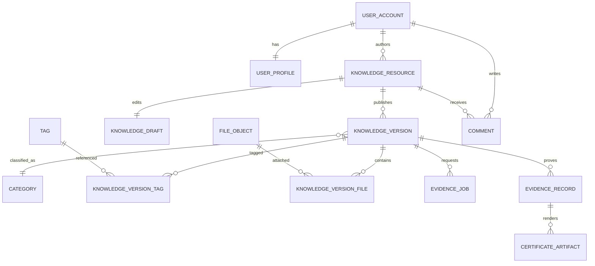

# 概念数据模型

- 状态：Accepted

## 1. 建模原则

- 业务表使用稳定无语义标识。
- 面向公开 URL 的对象另有不可猜测公共标识或 slug。
- 状态使用受控枚举并记录关键变化时间。
- 时间字段使用 UTC，命名区分创建、更新、发布、确认和删除。
- 关键唯一性同时由应用规则和数据库约束保护。
- 高频计数可以派生缓存，但原始关系是事实来源。

## 2. 账户域

### `user_account`

核心字段：用户标识、邮箱规范值、用户名规范值、状态、创建时间、更新时间、版本号。

约束：邮箱和用户名规范值唯一；状态受控；禁止硬删除已产生业务内容的用户。

### `user_profile`

核心字段：用户标识、显示名、简介、教育背景、头像文件标识、公开设置。

### `user_role`

核心字段：用户标识、角色、授予者、授予时间。

### `auth_credential` 与 `refresh_session`

分别保存密码哈希元数据和可撤销会话。刷新令牌只保存哈希，不保存明文。

## 3. 内容域

### `knowledge_resource`

资源稳定身份、作者、当前状态、当前公开版本、创建与更新时间、乐观锁版本。

### `knowledge_draft`

资源的可编辑内容、自动保存时间和编辑版本。每个资源默认只有一个活动草稿。

### `knowledge_version`

不可变发布快照：版本号、标题、摘要、正文规范内容、分类引用、版权声明、发布者、发布时间、内容规范版本、主摘要。

### `knowledge_version_tag`

发布版本与标签的多对多关系，保存稳定顺序。

### `knowledge_version_file`

发布版本与文件对象的关系，包含用途、显示名、顺序和发布时摘要引用。

已发布版本的内容字段不原地修改。公开更正生成新的版本。

## 4. 分类域

### `category`

名称键、slug、说明键、父分类、排序、状态和版本。

首版建议最多两级，防止无限树导致导航和权限复杂化。

### `tag`

规范名称、slug、说明、状态和使用统计派生值。

### `tag_alias`

同义词或旧称指向规范标签，用于搜索输入统一。

## 5. 互动域

### `resource_like`

用户与资源唯一关系，记录创建时间。

### `collection` 与 `collection_item`

收藏夹及资源关系。默认收藏夹不可被用户彻底删除，只可清空或改名规则受控。

### `comment`

资源、作者、父评论、正文、状态、创建与更新时间。回复层级受限，展示线程可通过根评论标识查询。

### `report`

举报主体、目标类型、目标标识、原因、状态、处理人和处理结果。

### `follow_relation`

关注者与被关注者唯一关系，并用约束阻止相同主体。

## 6. 通知域

### `notification`

接收者、类型、业务去重键、对象引用、安全参数、创建时间和已读时间。

### `notification_preference`

用户、事件类型、站内和外部通道开关。

外部发送状态独立保存，避免把站内已读与邮件送达混为一体。

## 7. 检索域

### `user_search_history`

本人可见的搜索词、结果数量和搜索时间。记录按用户隔离，支持单项删除、全部清空和保留上限；热门词只从聚合计数产生，不返回搜索者身份。

## 8. 文件域

### `file_object`

对象标识、所有者、用途、存储提供者、存储键、原始显示名、大小、声明 MIME、检测 MIME、SHA-256、状态和保留期限。

### `upload_session`

上传意图、过期时间、限制、已接收信息和完成状态。

## 9. 存证域

### `evidence_job`

资源版本、证明后端、幂等键、载荷版本、状态、尝试次数、下次执行、租约、最后错误分类和时间。

### `evidence_record`

证明公共标识、资源版本、作者证明标识、摘要、Merkle Root、证明来源、网络、交易、区块、确认时间和原始结果的受控存档引用。

### `verification_event`

证明引用、核验方式、结果、摘要、时间、匿名化调用来源和保留期限。

### `certificate_artifact`

证明记录、模板版本、文件对象、生成状态和生成时间。

## 10. 任务与审计

### `reliable_job`

任务类型、业务键、载荷版本、状态、租约、尝试次数、计划时间和错误分类。具体业务事实仍由对应模块表保存。

### `audit_event`

操作者、动作、目标类型、目标标识、原因、请求标识、结果、安全上下文和时间。只追加。

### `operational_alert`

去重后的组件、严重级别、安全摘要码、首次与最近出现时间、出现次数、状态、解决人、解决原因和乐观锁版本。它不保存原始日志、异常堆栈或请求正文。

## 11. 关键关系

## 12. 索引建议

- 所有外键建立与查询方向匹配的索引。
- 用户邮箱、用户名、资源公共标识、slug、幂等键和业务去重键唯一。
- 列表索引按照状态、发布时间和稳定次排序键设计。
- 评论按资源、状态、根评论和创建时间查询。
- 任务按状态、下次执行和租约查询。
- 审计按目标、操作者和时间查询。
- 索引设计以实际查询目录为依据，不为每个字段盲目建索引。

## 13. 保留与删除

- 会话和重置凭据按过期策略清理。
- 上传失败和核验临时文件短期保留后清理。
- 已发布版本、证明记录和审计事件长期保留。
- 用户发起删除请求时，公开资料按规则去标识化；证明事实保留最小必要引用。
- 派生搜索事件和分析数据使用明确保留期限。
